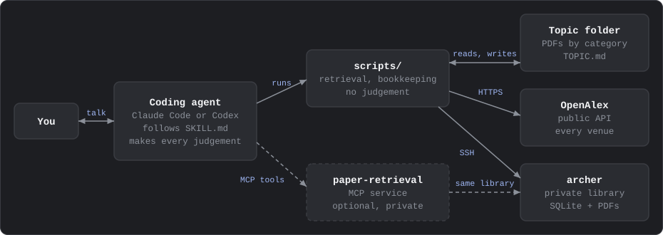
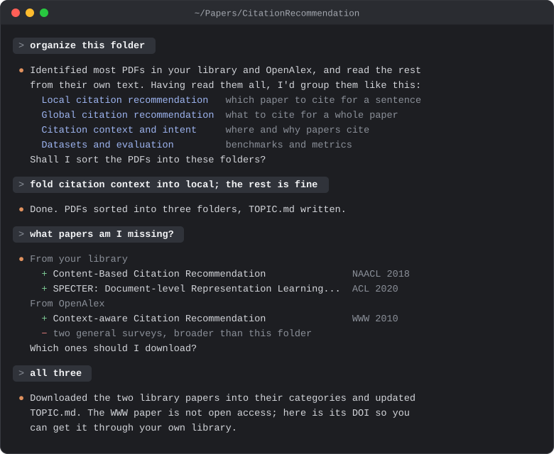
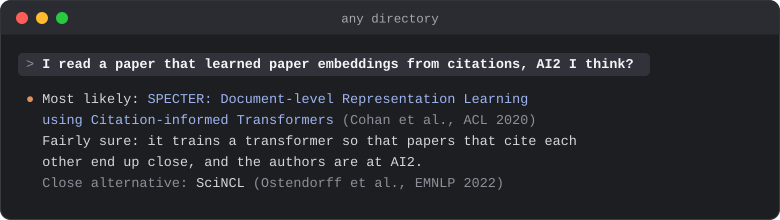

<div id="header" align="center">
  
  <h1>Paper Level Up</h1>
</div>


Organize a folder of papers with a coding agent (Claude Code / Codex), backed by
your own paper library.

You keep one folder per topic, full of PDFs named `[year VENUE]title.pdf`. Open
it with Claude Code or Codex, ask the agent to organize it, and it reads the
whole collection, proposes a taxonomy, sorts the PDFs into category subfolders,
and writes a `TOPIC.md`. It can then search your library for papers you're
missing, and answer paper questions that involve no folder at all.

> **Status: personal setup, published as a working reference.**
>
> One of the two sources is *my* paper library (`archer`) — a SQLite corpus of
> AI/ML papers with its own full-text index, and a PDF store, on a private
> host reached over SSH. That library is not part of this repo and is not
> something you can stand up from it.
>
> The other source is **OpenAlex**, which is public and needs no key. Setting
> `"sources": ["openalex"]` in the config gives you identification, keyword
> discovery and a citation graph without any private infrastructure — that path
> does run end-to-end on your machine. You lose the curated PDF store and the
> dense in-corpus edges.
>
> What is reusable regardless is everything above the corpus: the agent workflow
> in [`SKILL.md`](SKILL.md), the division of labour between agent and scripts,
> and the decisions in [Design notes](#design-notes).

## How it's put together

<p align="center">
  
</p>

The agent is the orchestrator, not a fixed pipeline. `scripts/` exposes
capabilities; `SKILL.md` tells the agent how to use them; every judgement — what
the categories should be, whether a discovered paper is relevant — happens in
conversation, where you can redirect it. Nothing is hardcoded as a prompt.

Retrieval and bookkeeping run in `scripts/` through a small source interface.
The private archer adapter ships short programs over SSH stdin and reuses one
connection per run, while the OpenAlex adapter calls its public HTTP API
directly. Nothing is installed on the library host; with the optional
Meilisearch backend, its key never leaves that machine.

## Setup

```bash
pip install pypdf
```

This checkout is the canonical copy at `~/.claude/skills/paperlevelup/`, where
Claude Code loads it. For Codex, expose the same checkout through its
user-level skills directory instead of copying it:

```bash
mkdir -p ~/.agents/skills
ln -s ~/.claude/skills/paperlevelup ~/.agents/skills/paperlevelup
```

Verify the link with `ls -l ~/.agents/skills/paperlevelup`, then restart Codex
if it was already running. One real copy means edits to `SKILL.md`, scripts,
tests and config are shared by both agents. The `name`/`description`
frontmatter at the top of `SKILL.md` controls when the skill is loaded; keep
that block intact when editing.

You only need SSH access when using the private library source (named
`archer` in ids and `--sources` for historical reasons; the host is whatever
`host` says). For an OpenAlex-only setup, set `"sources": ["openalex"]`. The
values tracked in `config/remote.json` are placeholders that document the shape;
put the real ones in `config/remote.local.json` (gitignored):

| Key | Meaning |
|---|---|
| `sources` | Which sources to use, in order |
| `host` | SSH alias of the library host |
| `db_path` | SQLite paper database on that host (`papers`, `paper_references`) |
| `pdf_root` | Directory that the database's relative `pdf_path` values resolve against |
| `search_backend` | `fts5`: keyword search and title matching use the database's own `papers_fts` table (nothing else needed on the host). `meili`: a Meilisearch index, configured below |
| `meili_url` / `meili_index` / `mustcite_root` | Meilisearch endpoint as seen from the host, and the directory whose `.env` holds `MEILI_KEY` (only for `meili`) |
| `match_threshold` | Title similarity needed to call two records the same paper |
| `openalex.mailto` | Your email, to join OpenAlex's faster "polite pool" |
| `openalex.timeout` | HTTP timeout in seconds |
| `openalex.allow_pdf_download` | Whether open-access PDFs may be downloaded from OpenAlex links |

Tests: `python3 tests/test_regressions.py`.

## Use it

Open the topic folder with Claude Code or Codex and talk to it. A typical
session:

<p align="center">
  
</p>

Nothing is moved before you agree to the taxonomy, and nothing is downloaded
before you pick. Adding more PDFs and asking to organize again is safe —
already-analysed papers are skipped. If you drag PDFs between category folders
yourself, the agent reads the new layout back before doing anything else.

When no source can identify a paper, the agent checks the PDF's title page and
records the correction together with its evidence. Corrections survive later
re-runs.

Without a folder, the same retrieval answers paper questions from any
directory:

<p align="center">
  
</p>

Other questions it handles:

| You ask | You get |
|---|---|
| "papers on X", "which papers do X?" | A list from the library, each with the passage that answers the question |
| "work related to this paper", "baselines for Y" | Papers linked to it by content and citations |
| "new entries for my awesome list" | Candidates the list does not already contain |
| A topic outside AI/ML venues | OpenAlex results |

In Claude Code, `/paperlevelup` invokes the skill explicitly. In Codex CLI or
the IDE extension, use `/skills` to confirm discovery and invoke it with
`$paperlevelup organize this folder`. Natural-language requests also trigger it
when they match the description in `SKILL.md`.

The scripts are meant to be run by the agent; [`SKILL.md`](SKILL.md) documents
each of them, and every script takes `--help`.

## What lands in the topic folder

```
MyTopic/
├── TOPIC.md                    generated report, links open the PDFs
├── <Category>/                 PDFs, physically sorted
│   └── [2025 EMNLP]Title.pdf
└── .paperlevelup/
    ├── papers.jsonl            one record per paper
    ├── taxonomy.json           this topic's categories
    ├── metadata-overrides.json hand-verified corrections, with evidence
    └── cache/                  raw API responses, per source
```

The folder is the source of truth. Records are keyed by filename, which
survives moves between categories.

Identity is a dict — `ids: {archer, openalex, doi}` — because no single id is
*the* identity once there is more than one backend: archer knows where the PDF
is, OpenAlex knows the DOI and the global citation count. DOI is the join key
between them. Each record also carries `provenance`, mapping every field to the
source it came from (or to `metadata_override` for a hand-verified correction).

## Two sources

During collection, configured sources are queried independently so their fields
can be merged. Later runs only query newly configured or previously untried
sources. Responses are cached under `<topic>/.paperlevelup/cache/`, so a re-run
stays off the network.

|  | **archer** (private) | **OpenAlex** (public) |
|---|---|---|
| Coverage | A fixed set of major AI/ML venues | Every venue |
| PDFs | All of them | Open access only |
| Abstracts | Nearly all | Most |
| Citation edges | Dense, but only between corpus papers | Global, but missing for many works |
| DOI, global citation count | — | Yes |

The blind spots are different in kind, which is the whole reason for having
both. archer misses whole **venues** — SIGIR, KDD, TKDE, ECIR, Scientometrics
and most journals are absent, so searching it for "local citation
recommendation" returns almost nothing. OpenAlex misses **reference lists**:
coverage depends on publisher and Crossref deposits, so a preprint-heavy folder
can have a much thinner citation graph. On real folders, archer alone leaves a
large share of papers unidentified; adding OpenAlex closes most of that gap.

## Channels for discovery

**Library search** (optional, private). If the agent has the tools of a
`paper-retrieval` MCP server connected — a separate retrieval service over the
same library, combining full-text BM25, embeddings, citation-graph expansion and
a reranker, and returning an evidence passage per result — `SKILL.md` makes it
the main search channel for the library. It returns archer's paper ids, so
its results can be fetched like any other. Without it, the skill falls back to
archer keyword search. On a curated list, the service recalled clearly more of
the known papers than keyword search with the same queries, but keyword search
still found some the service missed, so `SKILL.md` keeps one keyword pass as a
cross-check. The service itself is not part of this repo.

**Keyword** (`search.py`) searches every configured source. It works for every
paper in your folder, because the keywords come from reading the papers, not
from the papers being indexed. For OpenAlex it is the only search channel, and
it can run without a topic folder.

**Citation** (`graph.py`) walks the citation graph. Its `gaps` mode ranks by
lift rather than raw citation count: raw count just returns the field's famous
papers, while lift finds papers heavily cited inside your topic and obscure
outside it.

Results are reported **one block per source or channel, never merged into a
single ranking**. Lift needs a popularity denominator and the two do not share one:
archer can only count citations inside its own corpus, OpenAlex knows the global
count — which is what lift was always reaching for. Merging them would produce
numbers that look comparable and are not.

All channels over-recall on purpose and return abstracts. Nothing scores
relevance for you — the agent reads them and you correct it.

## Design notes

Two earlier ideas were tried and dropped:

- **A per-paper pipeline with fixed prompts and a fixed schema.** That
  architecture solves a scale problem these topics don't have (even the largest
  topic fits in one context). Worse, classifying one paper at a time means never
  seeing the collection's shape, so the hand-written taxonomy becomes a ceiling
  on quality. Reading everything at once and deriving the taxonomy from the
  actual distribution is strictly better at this scale.

- **Quantifying relevance for discovery.** Finding related work is subjective:
  you pull out keywords, search, skim abstracts, and decide. Encoding that as a
  score just freezes one person's judgement into a constant. The scripts recall
  widely and the judgement stays in the conversation, where it can be argued
  with.

A third decision came with the second source:

- **Field-level merge, not a source hierarchy.** The obvious design is "archer
  wins, OpenAlex fills gaps", but that is wrong: they are authoritative about
  different things, not the same things with different reliability. So metadata
  merges field by field against a fixed precedence table and each record records
  where every field came from. The same reasoning is why `graph.py` reports one
  block per source instead of one merged ranking — deduplicating by DOI is
  bookkeeping, but deciding whose top result beats whose is judgement, and
  judgement does not go in the scripts.

### Choosing a source, if you are adapting this

Semantic Scholar was the obvious third candidate — it parses references out of
PDFs, so it has the arXiv reference lists OpenAlex lacks, plus TLDRs and
citation intents. It was dropped for now: the unauthenticated pool rejects
essentially every request with HTTP 429, so it is not usable without an API
key. Worth adding behind a key if you have one.
